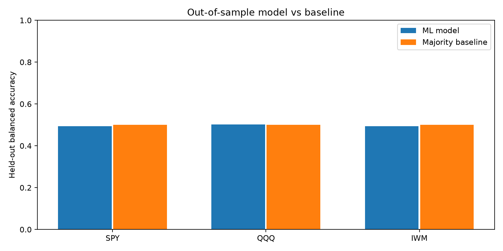
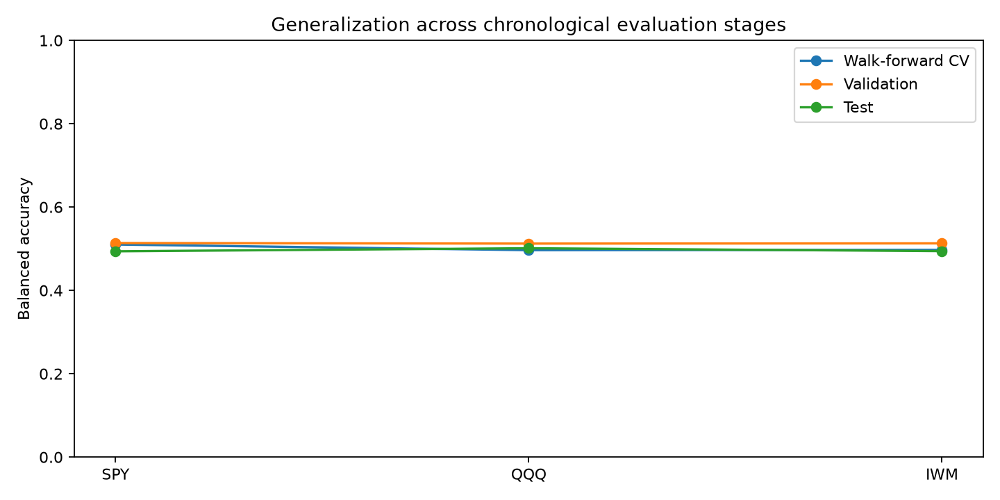

# Market Leakage Lab
### Leakage-Safe Financial Time-Series Machine Learning & Cross-Market Evaluation

A Python-based machine learning research pipeline for evaluating next-day market direction using historical price and volume data.

The system builds time-aware features, prevents future-data leakage, compares multiple classifiers, applies chronological and walk-forward validation, and measures out-of-sample performance against a statistical baseline.

**Python | scikit-learn | Pandas | NumPy | Matplotlib | Yahoo Finance**

---

## Project Overview

Market Leakage Lab investigates whether historical market information provides reliable predictive signals for the next trading session.

Rather than relying on random train/test splitting, the project follows chronological evaluation and explicitly accounts for the availability of information at prediction time.

The experiments cover three US exchange-traded funds:

- **SPY:** S&P 500 market exposure
- **QQQ:** Nasdaq-100 market exposure
- **IWM:** Russell 2000 small-cap market exposure

Each market is processed, trained, selected, and evaluated independently.

## Key Features

### Historical Market Data Processing

- Downloads historical daily OHLCV records from Yahoo Finance through yfinance.
- Validates trading dates, numeric prices, volume, and OHLC consistency.
- Sorts observations chronologically and rejects invalid records.
- Builds reproducible datasets for independent market experiments.

### Time-Aware Feature Engineering

Generates nine numerical features using current and historical market observations:

| Feature group | Engineered features |
| --- | --- |
| Price momentum | 1-day, 3-day, and 5-day returns |
| Rolling volatility | 5-day and 20-day return volatility |
| Intraday price behavior | High-low range and close-to-open return |
| Trading volume | Volume change and relative 10-day volume |

The prediction target is whether the next trading day's closing price exceeds the current closing price.

Features are constructed using information available after the current trading session closes.

### Leakage-Safe Experiment Design

- Chronological training, validation, and untouched test partitions.
- One-bar embargo at split boundaries to prevent label overlap.
- Expanding-window cross-validation using TimeSeriesSplit.
- Training-only feature scaling through scikit-learn Pipelines.
- Model selection using validation balanced accuracy without consulting the test results.
- Automated checks for future-data leakage and invalid target construction.

### Model Training and Comparison

The pipeline evaluates:

- Logistic Regression with standardized numerical features.
- Random Forest with controlled model complexity.
- Majority-class DummyClassifier as a baseline.

Candidate models are compared using walk-forward cross-validation and a separate chronological validation set.

The selected model is refitted on permitted pre-test history before final evaluation.

### Evaluation and Reproducibility

- Accuracy, balanced accuracy, precision, recall, F1-score, ROC-AUC where applicable.
- Confusion matrices and individual model comparison results.
- Dataset SHA-256 checksums and recorded experiment configurations.
- JSON and Markdown reports.
- Cross-market CSV summaries and visualizations.
- Automated Pytest checks and GitHub Actions CI.

## System Architecture

```text
Yahoo Finance Historical OHLCV
              |
              v
     Data Validation
              |
              v
    Feature Engineering
              |
              v
    Next-Day Target
              |
              v
 Chronological Data Splits
    Train / Validation / Test
              |
              v
 Expanding Walk-Forward CV
              |
              v
  Model Comparison & Selection
              |
              v
  Final Out-of-Sample Evaluation
              |
              v
 Cross-Market Results & Reports
```

## Experimental Methodology

The experiments use approximately 60% of labeled records for training, 20% for validation, and 20% for the final test period, with embargoed boundary observations.

The final test period remains chronologically separated from model development.

Model selection uses validation balanced accuracy, while the majority-class baseline establishes a reference for interpreting performance.

A fixed random seed and recorded dataset hashes support reproducibility.

## Experimental Results

### Cross-Market Evaluation

Experiments were conducted using real historical daily market data covering 2015 through October 2026.

| Market | Selected model | Test balanced accuracy | Majority baseline |
| --- | --- | ---: | ---: |
| SPY | Logistic Regression | 49.4% | 50.0% |
| QQQ | Random Forest | 50.1% | 50.0% |
| IWM | Random Forest | 49.4% | 50.0% |

The results show that the selected models did not establish a meaningful out-of-sample predictive advantage over the baseline.

This demonstrates the importance of chronological evaluation and baseline comparison when assessing financial ML systems.

### Model vs. Baseline



**Figure 1.** Held-out balanced accuracy of the selected model and majority-class baseline for each market.

### Generalization Across Evaluation Stages



**Figure 2.** Walk-forward cross-validation, validation, and held-out test balanced accuracy across the three experiments.

### Key Findings

- Validation-selected models did not consistently generalize to unseen market periods.
- A complex model does not automatically outperform a simple baseline.
- Chronological evaluation makes the assessment more representative of forward-looking prediction.
- Comparing several markets helps examine whether observed behavior is consistent across datasets.
- Daily OHLCV classification evaluates market direction, not order-book behavior or trading profitability.

Full metrics and individual experiment details are available in [Cross-Market Results](reports/portfolio/RESULTS.md).

## Technology Stack

| Technology | Purpose |
| --- | --- |
| Python | Data processing and experiment implementation |
| Pandas / NumPy | Time-series preparation and numerical features |
| scikit-learn | ML models, pipelines, metrics, and validation |
| Matplotlib | Comparative performance visualizations |
| yfinance | Historical market data retrieval |
| Pytest | Automated testing and leakage checks |
| GitHub Actions | Continuous integration |

## Running the Project

### Requirements

Python 3.11 or newer.

### Setup

```powershell
py -3.11 -m venv .venv
.\.venv\Scripts\python.exe -m pip install -r requirements-dev.txt
```

### Run Automated Tests

```powershell
.\.venv\Scripts\python.exe -m pytest -q
```

### Download Historical Data

```powershell
foreach ($symbol in @("SPY", "QQQ", "IWM")) {
    $name = $symbol.ToLower()
    .\.venv\Scripts\python.exe -m src.download --symbol $symbol --start 2015-01-01 --end 2026-11-01 --out "data/$name`_daily.csv"
}
```

### Run Market Experiments

```powershell
foreach ($symbol in @("SPY", "QQQ", "IWM")) {
    $name = $symbol.ToLower()
    .\.venv\Scripts\python.exe -m src.experiment --data "data/$name`_daily.csv" --source "Yahoo Finance $symbol daily OHLCV via yfinance" --out "outputs/$name"
}
```

### Generate Cross-Market Reports

```powershell
.\.venv\Scripts\python.exe -m src.summary
```

Generated results are saved under `outputs/` and `reports/portfolio/`.

Raw data are downloaded separately and are not redistributed with this repository. Provider revisions may affect reproduced results; dataset hashes in the experiment outputs identify the datasets used.

## Repository Structure

```text
market-leakage-lab/
|-- src/
|   |-- data.py
|   |-- download.py
|   |-- features.py
|   |-- experiment.py
|   `-- summary.py
|-- tests/
|-- data/
|-- outputs/
|-- reports/
|   `-- portfolio/
|       |-- RESULTS.md
|       |-- metrics.csv
|       |-- baseline_comparison.png
|       `-- generalization.png
|-- examples/
|-- .github/workflows/
|-- requirements.txt
|-- requirements-dev.txt
`-- README.md
```

## Research Context

This project is a compact daily-bar ML research workflow developed with AI assistance and locally validated against real historical datasets. It is designed to study reproducible model evaluation and future-data leakage prevention, not to represent a profitable trading strategy or a high-frequency order-book system.

## Author

**Muhammad Abbas**

Software Engineer | Machine Learning & Applied AI

[](https://github.com/MdAbbas762)

[](mailto:abbas63891@gmail.com)
