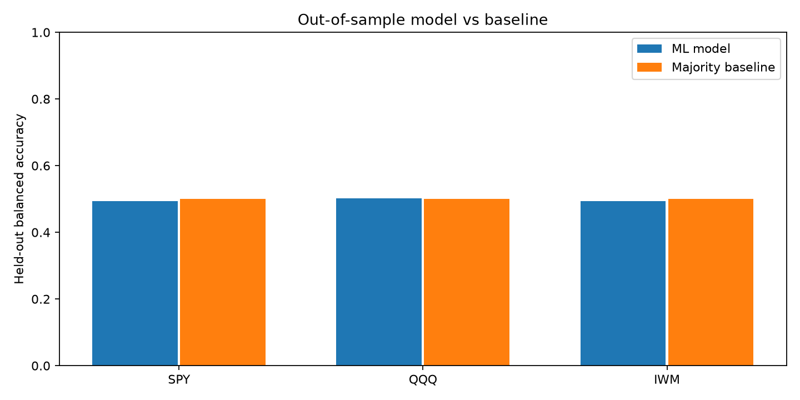
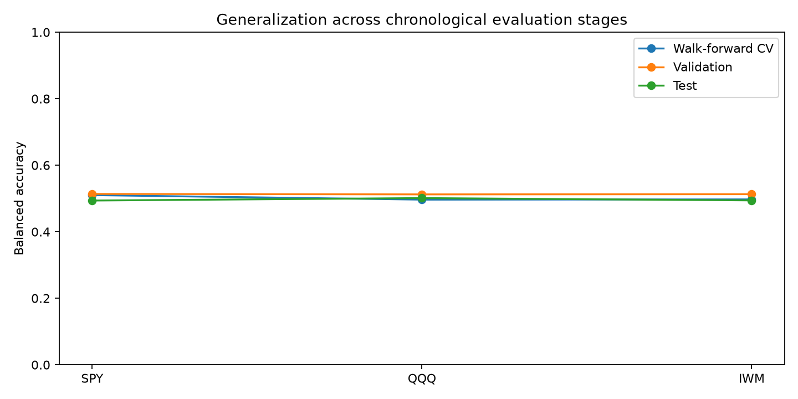

# Cross-Market ML Experiment Results

Independent experiments using real historical daily market data.
Models were selected using earlier validation data, not test results.

| Market | Selected model | Walk-forward CV | Validation | Test | Baseline |
| --- | --- | ---: | ---: | ---: | ---: |
| SPY | logistic_regression | 0.510 | 0.514 | 0.494 | 0.500 |
| QQQ | random_forest | 0.497 | 0.512 | 0.501 | 0.500 |
| IWM | random_forest | 0.497 | 0.513 | 0.494 | 0.500 |

## Findings

- **SPY** underperformed its baseline (0.494 vs 0.500); 591 test records; 2024-06-24 to 2026-10-29.
- **QQQ** outperformed its baseline (0.501 vs 0.500); 591 test records; 2024-06-24 to 2026-10-29.
- **IWM** underperformed its baseline (0.494 vs 0.500); 591 test records; 2024-06-24 to 2026-10-29.

These results measure held-out next-day classification, not HFT performance or trading profitability.

## Reproducibility

All experiments use chronological splits, a one-bar embargo, and expanding-window cross-validation.
Each market is trained and evaluated independently.
Raw data are downloaded from Yahoo Finance through yfinance.
